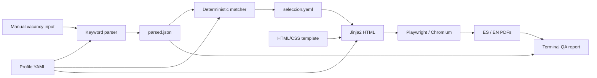

# CV Pipeline

A local Python tool that selects relevant content from a structured profile and generates Spanish and English CVs as PDFs.

The project reduces repetitive document editing when preparing applications for different vacancies. Matching is **deterministic and rule-based**: it detects known keywords, maps them to tags, and selects existing profile content. It does **not** use AI, call external APIs, translate automatically, or invent achievements.

This is a portfolio project and a personal desktop utility. It is not production-grade hiring software, an ATS simulator, or a validated predictor of job suitability.

## Pipeline

1. **Capture:** paste a vacancy and enter its metadata through the terminal or desktop GUI.
2. **Parse:** detect keywords from the profile's vocabulary using literal matching rules.
3. **Match:** map keywords to tags and rank summaries, experience bullets, and projects by tag overlap.
4. **Render:** combine selected content with a Jinja2 HTML template and export PDFs using Chromium through Playwright.
5. **QA:** inspect PDF text, page count, and literal keyword coverage. The terminal workflow runs this step; the GUI currently does not.



## Features

- Manual vacancy capture and batch processing.
- Reusable master profile with summaries, tagged achievements, projects, education, and skills.
- Spanish, English, or bilingual output using text already supplied in the profile.
- Configurable bullet and project limits in the standalone matcher.
- Fallback content when no tags match and a positive limit is requested; zero disables that selection.
- Full-profile mode that bypasses matching and includes all bullets and projects, with one summary.
- Terminal menus and a Tkinter desktop interface; interface messages are currently in Spanish.
- Human-guided keyword-to-tag mapping suggestions.
- HTML escaping, strict template variables, and validation of selection references before rendering.

## Technologies

Python, PyYAML, Jinja2, Playwright/Chromium, pdfplumber, and Tkinter. JSON and YAML preserve intermediate results; HTML/CSS define the document layout.

Only direct pip dependencies are listed in `requirements.txt`. Tkinter is supplied by the Python installation, and Playwright requires a separate Chromium installation. Regression tests use the standard library's `unittest`.

## Repository structure

```text
cv-pipeline/
├── README.md
├── LICENSE
├── requirements.txt
├── .gitignore
├── iniciar_gui.bat
├── examples/
│   ├── perfil.example.yaml
│   └── vacante.example.txt
├── src/
│   ├── config.py
│   ├── main.py
│   ├── gui.py
│   ├── nueva_vacante.py
│   ├── intake_common.py
│   ├── vacante_parser.py
│   ├── extractor_python.py
│   ├── matcher.py
│   ├── render.py
│   ├── qa.py
│   ├── curador_keywords.py
│   ├── cli_utils.py
│   ├── labels.py
│   └── utils.py
├── templates/
│   ├── cv_template.html
│   └── cv.css
└── tests/
    ├── test_rules.py
    ├── test_rendering.py
    └── test_examples.py
```

Local `master/`, `vacantes/`, virtual environments, and internal context are ignored. They are not needed in the public repository. Generated vacancy folders contain PDFs at their root and working artifacts in `_pipeline/`.

## Installation

Use Python **3.13** for the environment audited for this project. Other versions/platforms have not been verified. Run commands from the project root. The constraints allow patch updates within the audited dependency series; they are not a full transitive lockfile.

### Windows PowerShell

```powershell
python -m venv .venv
.\.venv\Scripts\python.exe -m pip install -r requirements.txt
.\.venv\Scripts\python.exe -m playwright install chromium
```

### macOS / Linux

```bash
python3.13 -m venv .venv
.venv/bin/python -m pip install -r requirements.txt
.venv/bin/python -m playwright install chromium
```

Some Linux installations also require browser system libraries and a separately installed Tkinter package. Consult the error reported by your Python/Playwright installation if either is missing. The desktop interface requires a graphical session.

## Basic usage

### Profile selection

The application reads a profile in this order:

1. The file specified by `CV_PIPELINE_PROFILE`, if set.
2. Local `master/perfil.yaml`, if it exists.
3. The fully fictional `examples/perfil.example.yaml`.

Relative override paths are resolved against the project root. An invalid explicit path produces an error rather than falling back silently. Set the variable before starting the application. No profile is copied or overwritten automatically.

To use the synthetic profile on a machine that already has private data:

```powershell
$env:CV_PIPELINE_PROFILE = "examples/perfil.example.yaml"
.\.venv\Scripts\python.exe src/main.py
# Restore default profile selection after finishing:
Remove-Item Env:CV_PIPELINE_PROFILE
```

```bash
CV_PIPELINE_PROFILE=examples/perfil.example.yaml .venv/bin/python src/main.py
```

For the desktop interface, use `src/gui.py` instead of `src/main.py`. The optional Windows launcher `iniciar_gui.bat` expects an environment named `venv`, whereas these installation instructions use `.venv`; launch the GUI directly with the interpreter above when using `.venv`.

The terminal menu supports vacancy-specific CVs and full-profile CVs. Use a new folder name for each full-profile run if you want to preserve older outputs: repeating a name replaces its generated files. Full-profile folder names must be single valid names, not paths.

### Run the synthetic vacancy through individual stages

The following creates a new, unique demo folder under the ignored `vacantes/` directory. It does not replace an existing working profile or vacancy. The profile override is required when private data already exists.

Windows PowerShell:

```powershell
$env:CV_PIPELINE_PROFILE = "examples/perfil.example.yaml"
$demo = "vacantes/demo_" + [guid]::NewGuid().ToString("N")
New-Item -ItemType Directory -Path "$demo/_pipeline" | Out-Null
Copy-Item -LiteralPath "examples/vacante.example.txt" -Destination "$demo/_pipeline/raw.txt"
.\.venv\Scripts\python.exe src/vacante_parser.py $demo
.\.venv\Scripts\python.exe src/matcher.py $demo --max-bullets 1 --max-proyectos 1
.\.venv\Scripts\python.exe src/render.py $demo --lang both
.\.venv\Scripts\python.exe src/qa.py $demo
Remove-Item Env:CV_PIPELINE_PROFILE
```

macOS / Linux:

```bash
export CV_PIPELINE_PROFILE=examples/perfil.example.yaml
mkdir -p vacantes
demo=$(mktemp -d ./vacantes/demo.XXXXXX)
mkdir "$demo/_pipeline"
cp examples/vacante.example.txt "$demo/_pipeline/raw.txt"
.venv/bin/python src/vacante_parser.py "$demo"
.venv/bin/python src/matcher.py "$demo" --max-bullets 1 --max-proyectos 1
.venv/bin/python src/render.py "$demo" --lang both
.venv/bin/python src/qa.py "$demo"
unset CV_PIPELINE_PROFILE
```

Expected outputs are `cv_es.pdf`, `cv_en.pdf`, and `reporte_qa.txt`, plus intermediate files in `_pipeline/`. The demo URL uses the reserved `.invalid` domain and is not a real website.

To customize your own local profile, create `master/perfil.yaml` using the example's schema **only if that file does not already exist**. All of `master/` is ignored. Supply English fields yourself; missing translations fall back to Spanish with a warning.

## Tests

```powershell
.\.venv\Scripts\python.exe -B -m unittest discover -s tests -v
```

```bash
.venv/bin/python -B -m unittest discover -s tests -v
```

Tests cover keyword boundaries, invalid dates, reference validation, selection limits/fallbacks, safe folder names, HTML escaping, translation fallback, profile precedence, and the synthetic workflow through HTML. They use temporary directories and synthetic data. They do not launch Chromium or generate PDFs.

## Privacy design

- Private profiles and keyword state remain in ignored `master/`.
- Real vacancies, intermediate HTML, and generated CVs remain in ignored `vacantes/`.
- Virtual environments, bytecode, environment files, internal context, and local audit material are ignored.
- Public examples contain fictional candidates, institutions, employers, and content; they do not reproduce working data.
- The application has no implemented AI provider or external-service client and sends no application data to such services.
- Treat profiles as plain text; injected HTML is escaped during rendering.

`.gitignore` protects normal staging of untracked files; it does not prevent force-adding a file or sanitize arbitrary exports/screenshots. Review the files selected for publication, and keep private artifacts in the ignored directories.

## Current limitations

- Keyword detection depends on a manually maintained vocabulary and literal spelling; it does not understand negation or semantic equivalence.
- Matching uses unweighted tag overlap, stable input-order tie breaking, and fallback content. Skills and education are not filtered by vacancy.
- Experience extraction only recognizes a narrow Spanish expression and does not influence selection.
- Keyword coverage is a literal text check over known detected keywords, not a hiring score or ATS certification. Cross-language terminology can lower coverage.
- QA runs automatically only in the terminal workflow and may inspect PDFs left by previous runs in the same folder.
- There is no automatic translation or rewriting. Project titles currently use their original names even when `nombre_en` is present.
- Selection references and template fields are checked, but the entire profile does not yet have comprehensive schema validation.
- A failure interrupts the current batch; the GUI does not restore its cleared pending queue.
- PDF pagination depends on content length, installed fonts, and Chromium. Visual layout and clean-install behavior across platforms need further verification.
- Windows `.url` shortcuts and the `.bat` launcher are platform-specific conveniences.

## Roadmap

- Integrate QA into the GUI and improve batch error recovery.
- Validate the complete profile schema and provide clearer configuration errors.
- Improve bilingual QA and explain selection scores.
- Add automated CI for the focused regression tests.
- Verify installation and PDF output on clean machines.

## License

MIT. See `LICENSE`.
